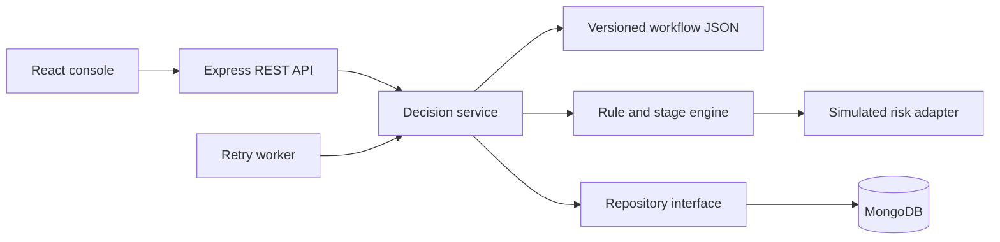

# Architecture

## Boundaries and data flow

1. `POST /api/requests` selects a workflow version and validates the payload against its configured input fields. Unknown fields are rejected.
2. The service computes a canonical SHA-256 payload hash and inserts a request with `RECEIVED` status. MongoDB's unique `(workflowId, idempotencyKey)` index makes duplicate submission atomic across API instances. A matching duplicate returns the existing request; a mismatched one is a conflict.
3. A processor claims the request by atomically setting `PROCESSING`, a lease owner, and a 30-second lease expiry. The worker can claim `RECEIVED`, due `RETRY_PENDING`, or expired `PROCESSING` requests.
4. Each configured stage runs in order. Checks produce pass, fail, or skipped traces; routing rules produce matched or not matched traces. Each trace includes the field path, observed value, operator, and expected value. A rule may choose a terminal outcome. The risk adapter returns a deterministic score or a simulated transient error.
5. The repository atomically updates stage index, context, lifecycle state, and audit events in one document update. An optimistic filter on version, stage index, and lease owner prevents two processors from committing the same stage.
6. A dependency error records failure and schedules exponential backoff. After the configured maximum attempts, it routes to `MANUAL_REVIEW`. An operator can resolve review with an audited decision and note.

## Data model

One `decision_requests` document contains `id`, workflow ID and pinned version, input, payload hash, idempotency key, context, status, stage index, attempt count, lease, retry time, timestamps, current `explanation`, and an ordered `audit` array. Every approved, rejected, review, or retry outcome records its generated explanation in an audit decision event. The input snapshot and each rule result are preserved in audit events. The list endpoint omits audit arrays; the detail endpoint returns the complete history.

States are `RECEIVED`, `PROCESSING`, `RETRY_PENDING`, `APPROVED`, `REJECTED`, and `MANUAL_REVIEW`. Manual review can be resolved once into approval or rejection. Configuration versions are immutable by convention; the request pins its version, so later rules cannot alter an existing decision.

## Consistency and failure behavior

- **Duplicate requests:** the unique index is the source of truth. Idempotency is scoped to a workflow ID, and the key conflicts if reused with a different version or input. The hash sorts object keys so JSON field order does not change identity.
- **Partial save failure:** a stage and its audit entries share one atomic MongoDB document update. If the update fails, neither transition nor audit is committed. The lease expires and a worker retries the same stage. A `RECEIVED` request is also picked up if initial processing failed after insertion.
- **Dependency failure:** the simulator accepts a stable operation key (`request ID:stage ID`). It can fail once or always. The configured retry policy controls delay and exhaustion. The default sample policy is five attempts starting at one second, with a one-minute delay cap.
- **Crash and concurrency:** expiring leases recover interrupted processors, and optimistic updates prevent stale processors from overwriting newer state. A dependency can be called more than once after a crash; a real external adapter must accept and honor the stable operation key to make repeated calls safe.
- **Review resolution:** the repository changes `MANUAL_REVIEW` to a final status and appends the operator's reason in one atomic update. A second resolution fails with `409`.

## Configuration model

Each JSON definition has `id`, integer `version`, `input`, ordered `stages`, `defaultOutcome`, and optional `retryPolicy`. A `rules` stage contains predicates and `onPass` or `onFail` outcomes. Rules with `kind: "branch"` show matched or not matched results; other rules show pass or fail. A `when` predicate skips a rule when its condition does not apply. A `dependency` stage names an adapter. The workflow loader validates IDs, stage types, operators, outcomes, and retry settings on startup. Application versions 1 and 2 change thresholds; vendor approval shows conditional branching with the same engine.

## Tradeoffs and assumptions

- **Embedded audit array:** this keeps every stage transition and its audit entries atomic without requiring MongoDB multi-document transactions or a replica set. Very long workflows could approach MongoDB's document size limit. At larger scale, move audit events to an append-only collection and use transactions or an outbox, with pagination in the detail API.
- **Source-controlled configurations:** simple to review and deploy, and safe for in-flight version pinning. Runtime rule editing would need a configuration store, approval flow, validation, and immutable published versions.
- **Synchronous initial processing:** the caller usually gets a final decision immediately. Slow external services would hold the HTTP request; production should enqueue processing and return `202` with a polling URL.
- **In-process retry worker:** easy to operate for a small deployment. Multiple instances remain safe because claims are atomic, but high throughput calls for a dedicated worker fleet, queue, and metrics.
- **Demo authentication:** this assignment UI has no login. In production, protect review endpoints with role-based authorization and derive the operator from authenticated identity rather than request JSON.
- **External simulation:** the risk adapter is intentionally deterministic and side-effect free. It demonstrates failures and replay but is not a production risk model. Real adapters need timeouts, idempotency contracts, observability, and circuit breaking.

## Scaling and operations

The unique idempotency index and status/retry indexes support the current query paths. Horizontal API and worker replicas can share MongoDB; the compare-and-swap stage update and lease claim coordinate them. For larger volumes, partition or shard by tenant/request key, cap list queries with pagination, archive old audit histories, and track retry lag, attempt counts, dependency failures, and manual review backlog. Sensitive input and audit fields require access controls and retention rules before production use.
